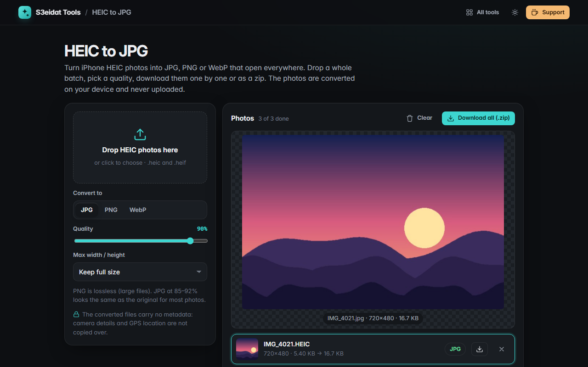

# HEIC to JPG

> Convert iPhone HEIC/HEIF photos to JPG, PNG or WebP. Free, private, and it runs entirely in your browser.

### ▶ [Open HEIC to JPG](https://s3eidat.github.io/heic-to-jpg/)



## Features

- **Batch convert** `.heic` / `.heif` photos to **JPG, PNG or WebP** (WebP where the browser can write it)
- **Quality slider** for JPG and WebP, optional **max width/height** with high-quality downscaling
- Rotation stored in the file is applied, so photos come out upright
- Converts the **main (primary) image** of each file and tells you when a file holds more than one image
- Thumbnails, per-file status, a large preview, single downloads or **Download all (.zip)**
- The converted files carry **no metadata**: camera details and GPS location are not copied over
- Decoding runs in a Web Worker, so the page stays responsive during big batches

## Privacy

Your photos never leave your device. There is no server, no account, no analytics.
The page ships with a strict Content-Security-Policy (`connect-src 'self'`), so the browser
itself blocks any attempt to send data anywhere. The policy adds `'wasm-unsafe-eval'` only so the
browser can compile the WebAssembly decoder; JavaScript `eval` stays blocked.

## Third-party code

HEIC decoding uses **[libheif](https://github.com/strukturag/libheif)** through the
**libheif-js 1.19.8** WebAssembly bundle (`lib/libheif-bundle.js`), included **unmodified**.
libheif is licensed under the **GNU LGPL v3**; its full license text is in `lib/libheif.LICENSE`.
You can replace `lib/libheif-bundle.js` with your own build of libheif-js and the tool will use it.

`sample.js` holds a few small HEIC files made from generated pictures (no real photos), used by the
built-in self-test and the demo.

## Run it yourself

It's plain HTML, CSS and JavaScript with no build step:

```bash
git clone https://github.com/s3eidat/heic-to-jpg
cd heic-to-jpg
python -m http.server 8000
```

Then open http://localhost:8000. (Opening `index.html` straight from disk won't work: browsers
don't allow Web Workers on `file://` pages.)

## Support

If this saved you time, **[buy me a coffee ☕](https://s3eidat.github.io/coffee/)**. It keeps every tool free.

---

Part of **[S3eidat Tools](https://s3eidat.github.io/)**: 100+ free, private tools that run in your browser. MIT licensed (libheif: LGPL v3).
